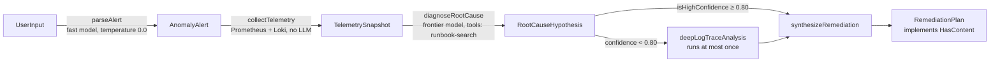

# Blueprint 01: GOAP / OODA incident and FinOps remediation agent

**Status: done** (with Embabel substituted, see below). 20 offline tests, all passing
(`mvn -B verify -pl blueprint-01-goap-finops-incident-agent -am`).

The module has two agents that share one A* GOAP planner (`planner/GoapPlanner.java`):

1. **`CloudRemediationAgent`: the handbook's Blueprint 1.** It investigates a latency or cost alert and returns a
   verified `RemediationPlan`. It runs on a small Embabel-style agent platform in `platform/`: `@Agent`, `@Action`,
   `@Condition` and `@AchievesGoal` annotations, with preconditions read from parameter types and effects from return
   types. No LLM picks the next step; the planner does, and it re-plans after every action (OODA loop).
2. **`FinOpsIncidentAgent`**: the original cost-spike agent over a billing CSV (`/api/incidents/run`). It is kept as a
   second, simpler example.

## Blueprint 1: what runs



| Handbook requirement | Where |
|---|---|
| Records `AnomalyAlert`, `TelemetrySnapshot`, `RootCauseHypothesis`, `RemediationPlan` (`HasContent`), with `@JsonClassDescription` / `@JsonPropertyDescription` | `incident/*.java` |
| `@Agent CloudRemediationAgent` with `parseAlert` (temperature 0.0), `collectTelemetry` (no LLM), `diagnoseRootCause` (`toolGroups = "runbook-search"`), `@Condition isHighConfidence` (≥ 0.80), `deepLogTraceAnalysis`, `@AchievesGoal synthesizeRemediation` | `incident/CloudRemediationAgent.java` |
| `PrometheusMetricsClient`, `LokiLogClient` | interfaces in `incident/`; `InMemoryTelemetry` is the offline implementation |
| Model mixing: fast local model for extraction, frontier model for diagnosis and synthesis | `platform/LlmOptions` roles `fast` / `frontier`; model names from `GOAP_FAST_MODEL`, `GOAP_FRONTIER_MODEL` |
| `POST /api/v1/incidents/investigate` | `incident/IncidentInvestigationController.java` |
| Spring Shell command `execute "..." -p -r` | `incident/IncidentShellCommands.java`, `shell` profile |
| Tests (a) prompt contains exact service names and log lines, (b) `collectTelemetry` makes zero LLM calls, (c) confidence < 0.80 triggers the deep-trace path | `CloudRemediationAgentTest` (8 tests), `IncidentInvestigationApiTest` (2) |

Offline, both model roles use `DemoIncidentModel`, a deterministic stub that answers each step's `TASK:` marker with
JSON. Its first diagnosis of `payment-service` is deliberately 0.55 confident, so you can watch the replanning.

## Run it (Windows PowerShell)

The app listens on port **8081** by default. If that port is taken, set `$env:PORT = 18081` and use that port below.

```powershell
mvn -B -pl blueprint-01-goap-finops-incident-agent -am spring-boot:run
# second terminal: the handbook agent
curl.exe -X POST http://localhost:8081/api/v1/incidents/investigate -H "Content-Type: application/json" `
  -d '{\"alert\":\"Investigate latency spike on payment-service: p99 2950 ms over 500 ms\"}'
# the billing-CSV agent
curl.exe -X POST http://localhost:8081/api/incidents/run -H "Content-Type: text/csv" --data-binary "@blueprint-01-goap-finops-incident-agent/src/main/resources/billing-sample.csv"
```

The first call returns `goalAchieved: true`, the actions in order (`parseAlert`, `collectTelemetry`,
`diagnoseRootCause`, `deepLogTraceAnalysis`, `synthesizeRemediation`), every LLM call with its role, temperature and
tools, and the plan (roll back deploy `a1b2c3d`).

### Interactive shell

```powershell
mvn -B -pl blueprint-01-goap-finops-incident-agent -am package -DskipTests
$env:SPRING_PROFILES_ACTIVE = "shell"
java -jar blueprint-01-goap-finops-incident-agent/target/blueprint-01-goap-finops-incident-agent-0.1.0-SNAPSHOT.jar
shell:> execute "Investigate latency spike on payment-service: p99 2950 ms over 500 ms" -p -r
```

`-p` prints every prompt, `-r` prints the planner trace. Without the `shell` profile Spring Shell's auto-configuration
is excluded, so normal program arguments are never read as shell commands.

### With Ollama

The module has no Ollama dependency
yet, so the handbook agent runs offline only. To try real models, add `spring-ai-starter-model-ollama`, start with
`BLUEPRINTS_MODEL=ollama`, and set `GOAP_FAST_MODEL=qwen2.5-coder:7b`, `GOAP_FRONTIER_MODEL=llama3.2:3b` (on an
8 GB PC use `llama3.2:3b` for both). This path has **not** been run.

## Why not Embabel? (substitution)

Embabel's latest release on Maven Central (1.5.3) targets **Spring Boot 4.1.1**; this repo is pinned to Boot 4.0.8
everywhere, and its tests must be offline. So `platform/` re-implements the part of Embabel the handbook relies on:
annotations, type-driven preconditions and effects, conditions, replanning, tool groups and per-call model options.
`LlmInvocation` records play the role of Embabel's `FakeOperationContext`, and the Spring Boot test plays the role of
`EmbabelMockitoIntegrationTest`. Moving to real Embabel later is mostly a change of imports; see `exercises.md`.

See also [`theory.md`](theory.md), [`examples/README.md`](examples/README.md) and [`exercises.md`](exercises.md).
