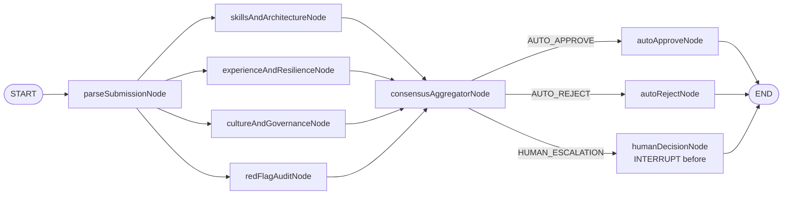
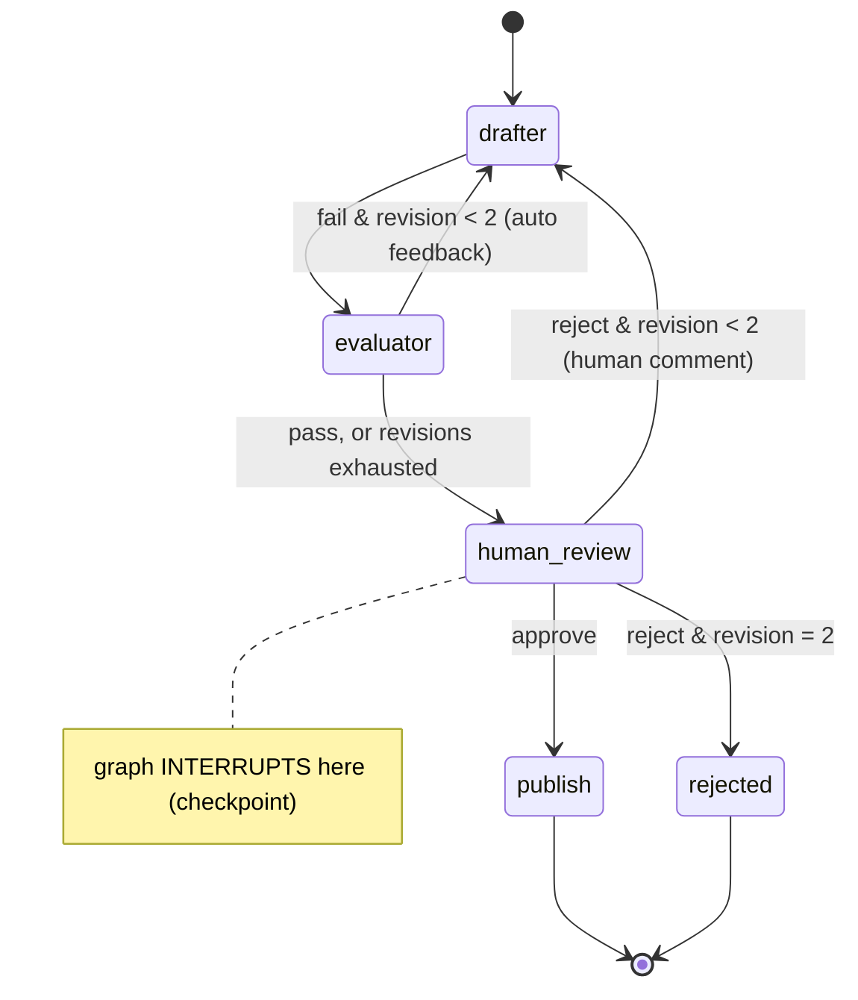

# Blueprint 02: LangGraph4j HITL multi-agent evaluation

**Status:** done · **Handbook:** Part III, Blueprint 2 · 25 offline tests

This module has two LangGraph4j 1.9.5 graphs.

1. **Submission review graph (the handbook's Blueprint 2), `/api/v1/workflows`.** A candidate or vendor
   document is parsed into a profile. Four evaluator agents then score it **in parallel on virtual
   threads**, and a consensus aggregator routes it to one of three exits: auto-approve, auto-reject, or
   pause for a human (`interruptBefore("humanDecisionNode")`). The paused thread is checkpointed. It
   can be in memory, or durable in a database through `JdbcCheckpointSaver`, so it survives a restart.
2. **Draft review graph, `/api/reviews`.** A drafter writes an answer, an evaluator gates it with Spring
   AI evaluators, and a human approves or sends it back with a comment. This one predates the PDF
   check and is kept as a second example.

## 1. Submission review graph



**Routing rules** (`ConsensusPolicy`). The composite score and the spread are taken over the three
capability scores.

| Condition | Exit |
|---|---|
| any `CRITICAL:` red flag, or the evaluators' scores differ by more than 25 points | human escalation |
| composite ≥ 85 and no red flags | auto-approve |
| composite < 50 | auto-reject |
| anything else (the ambiguous middle, or a high score with minor flags) | human escalation |

The red-flag auditor's own integrity score is shown but not averaged in, because its role is to veto.
This weighting is the author's design: the handbook does not say how the audit score is weighed.

| Handbook item | Where |
|---|---|
| `ReviewWorkflowState`: submissionId, rawDocumentText, parsedProfileJson, dimensionScores, redFlags, decision, humanVerdict | `submission/ReviewWorkflowState.java`. `dimensionScores` uses a custom reducer (merge by dimension); `redFlags`, `critiques` and `nodeLog` use appender channels |
| 4 parallel evaluators on virtual threads | `SkillsAndArchitectureNode`, `ExperienceAndResilienceNode`, `CultureAndGovernanceNode`, `RedFlagAuditNode`, run through `addParallelNodeExecutor` |
| consensus aggregator with the 3 exits | `ConsensusAggregatorNode`, `ConsensusPolicy` |
| `interruptBefore("humanDecisionNode")`, then `updateState` and resume | `SubmissionReviewGraph`, `SubmissionWorkflowService` |
| MemorySaver for dev, durable JDBC/PostgreSQL saver for prod | `blueprints.hitl.checkpoint=memory` or `jdbc`; `JdbcCheckpointSaver` extends `AbstractCheckpointSaver` and uses LangGraph4j's `StdCheckpointListSerializer` |
| node hooks for tracing spans and timeouts | `NodeExecutionHooks`: one Micrometer `Observation` per node (it becomes an OpenTelemetry span if the OTel bridge is on the classpath) and a hard per-node timeout |
| `POST /api/v1/workflows/start`, `GET /{threadId}/state`, `POST /{threadId}/resume` | `SubmissionWorkflowController` |
| provider switch `llm.provider=mock / ollama / openai` | `mock` (default) is `MockEvaluatorModel`, a keyword-based test double. Any other value uses the app's `ChatModel`. Ollama is available under `-Pit` with `BLUEPRINTS_MODEL=ollama` (**not run here**). OpenAI needs its starter added and a key, so it is **not wired**. |
| tests for the 3 exits and pause/resume | `SubmissionReviewGraphTest` (8), `JdbcCheckpointSaverTest` (restart survival), `SubmissionWorkflowApiTest` (HTTP, using the JDBC saver), `ConsensusPolicyTest` (7) |
| batch smoke script | [`../scripts/smoke-test-workflows.sh`](../scripts/smoke-test-workflows.sh) |

Sample documents are in `src/main/resources/submissions/`. `strong.md` is auto-approved, `weak.md` is
auto-rejected, `mixed.md` is escalated because the evaluators disagree, and `critical.md` has high
scores but a falsified-dates flag, so it is escalated too.

```bash
mvn -B -pl blueprint-02-langgraph4j-hitl-evaluation -am spring-boot:run     # port 8082 (PORT to change)
scripts/smoke-test-workflows.sh http://localhost:8082                        # bash + curl
```

To keep checkpoints durable, set `HITL_CHECKPOINT=jdbc`. In production, also point
`SPRING_DATASOURCE_URL` (plus `SPRING_DATASOURCE_USERNAME` and `SPRING_DATASOURCE_PASSWORD`) at PostgreSQL,
for example the `postgres-pgvector` service in `docker-compose.ai-support.yml`. The table
`lg4j_checkpoints` is created on startup. It has been tested on H2 only; PostgreSQL was **not run here**.

## 2. Draft review graph



## LangGraph4j version check
- Checked on Maven Central on 17 Oct 2026: `org.bsc.langgraph4j:langgraph4j-core` **1.9.5** (latest release).
- It's compiled for Java 17 bytecode (class major 61), so it runs on Java 21.
- It builds and its tests pass here alongside Spring Boot 4.0.8 and Spring AI 2.0.1.
- No home-made graph engine was needed.

## What's here
| Path | Purpose |
|---|---|
| [theory.md](theory.md) | Graphs vs chains, checkpoints and interrupts, multi-agent roles |
| [examples/](examples) | REST walkthrough, embedding the graph |
| [exercises.md](exercises.md) | Practice tasks |
| `ReviewState` | Typed graph state (`history` uses an appender channel) |
| `ReviewGraph` | Nodes, conditional edges, `interruptBefore(human_review)`, `MemorySaver` |
| `ReviewWorkflow` | start, view and decide (`updateState` + `GraphInput.resume()`) |
| `web/ReviewController` | `POST /api/reviews`, `GET /api/reviews/{id}`, `POST /api/reviews/{id}/decision` |

## Draft review graph tests (7, offline)
`ReviewWorkflowTest` (6):
- a good draft pauses, then publishes on approval;
- a hallucinated draft is auto-revised *before* a human sees it, and the drafter receives the feedback;
- after 2 failed revisions it escalates to a human;
- a human rejection triggers a revision carrying the comment;
- a rejection at the limit ends `REJECTED`;
- threads are isolated, and a finished review can't be decided again.

`ReviewApiTest` (1): the whole flow over HTTP.

## Run
```bash
mvn -B -pl blueprint-02-langgraph4j-hitl-evaluation -am verify
mvn -pl blueprint-02-langgraph4j-hitl-evaluation -am spring-boot:run   # port 8082
```

## Notes *(author's design, not from handbook)*
- `MemorySaver` keeps checkpoints in memory and **drops a thread's checkpoints once the graph
  reaches END** (we saw this in testing). `ReviewWorkflow` therefore keeps the final state of finished
  reviews itself. Use a persistent checkpoint saver and a table in production.
- With the default echo stub, the drafter just repeats the question, so the drafts aren't meaningful.
  Depending on how many words overlap with the context, the evaluator may fail them, and the review then
  escalates to a human after 2 revisions. Plug in Ollama for real drafts.
