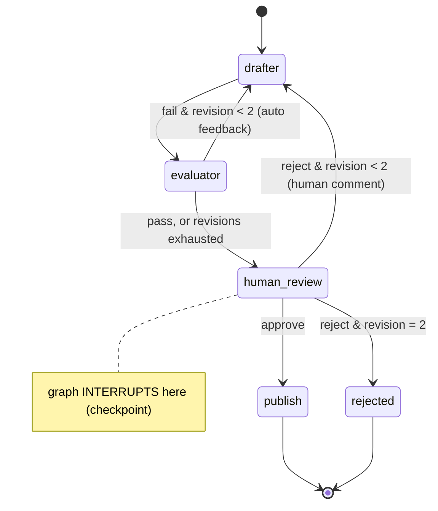

# Blueprint 02: LangGraph4j HITL multi-agent evaluation

**Status:** done · **Handbook:** Part III, Blueprint 2

A **LangGraph4j 1.9.5** state graph in which a *drafter* agent writes an answer and an *evaluator*
agent gates it with Spring AI evaluators (reusing `pillar-eval-gates`). The graph then **pauses
for a human**. The paused state is checkpointed, so a person can review it later over REST and
approve or reject it. A rejection sends the draft back to the drafter with the reviewer's comment.



## LangGraph4j version check
- Checked on Maven Central on 17 Oct 2026: `org.bsc.langgraph4j:langgraph4j-core` **1.9.5** (latest release).
- It's compiled for Java 17 bytecode (class major 61), so it runs on Java 21.
- It builds and its tests pass here alongside Spring Boot 4.0.8 and Spring AI 2.0.1.
- No home-made graph engine was needed.

## What's here
| Path | Purpose |
|---|---|
| [theory.md](theory.md) | Graphs vs chains, checkpoints and interrupts, multi-agent roles |
| [examples/](examples) | REST walkthrough, embedding the graph |
| [exercises.md](exercises.md) | Practice tasks |
| `ReviewState` | Typed graph state (`history` uses an appender channel) |
| `ReviewGraph` | Nodes, conditional edges, `interruptBefore(human_review)`, `MemorySaver` |
| `ReviewWorkflow` | start, view and decide (`updateState` + `GraphInput.resume()`) |
| `web/ReviewController` | `POST /api/reviews`, `GET /api/reviews/{id}`, `POST /api/reviews/{id}/decision` |

## Tests (7, offline)
`ReviewWorkflowTest` (6):
- a good draft pauses, then publishes on approval;
- a hallucinated draft is auto-revised *before* a human sees it, and the drafter receives the feedback;
- after 2 failed revisions it escalates to a human;
- a human rejection triggers a revision carrying the comment;
- a rejection at the limit ends `REJECTED`;
- threads are isolated, and a finished review can't be decided again.

`ReviewApiTest` (1): the whole flow over HTTP.

## Run
```bash
mvn -B -pl blueprint-02-langgraph4j-hitl-evaluation -am verify
mvn -pl blueprint-02-langgraph4j-hitl-evaluation -am spring-boot:run   # port 8082
```

## Notes *(author's design, not from handbook)*
- `MemorySaver` keeps checkpoints in memory and **drops a thread's checkpoints once the graph
  reaches END** (we saw this in testing). `ReviewWorkflow` therefore keeps the final state of finished
  reviews itself. Use a persistent checkpoint saver and a table in production.
- With the default echo stub, the drafter repeats the question, so the evaluator fails it and it
  escalates to a human after 2 revisions. Plug in Ollama for real drafts.
