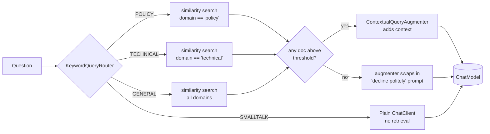

# Blueprint 03: Modular, branching, conditional RAG (Docling, PGVector)

**Status:** done · **Handbook:** Part III, Blueprint 3

A RAG service built from Spring AI's modular RAG parts. A **router** sends each question down a
branch. A **domain-filtered retriever** searches only the matching part of the corpus. A
**conditional augmenter** makes the model decline when nothing relevant is found, instead of
making something up. Production storage is **pgvector**. Tests use an in-memory `SimpleVectorStore`
with deterministic stub embeddings. The module also contains a **measured TOON-vs-JSON token comparison**.



Ingestion (ETL): `corpus/<domain>/*.md` → `MarkdownSectionParser` (or `DoclingStubParser` for `.pdf`/`.docx`)
→ adds `domain`, `source` and `section` metadata → `VectorStore.add`.

## What's here
| Path | Purpose |
|---|---|
| [theory.md](theory.md) | Modular RAG, branching vs conditional, TOON with **measured** numbers |
| [examples/](examples) | curl walkthrough, swapping in pgvector + Ollama |
| [exercises.md](exercises.md) | Practice tasks |
| `routing/` | `QueryIntent`, `QueryRouter`, `KeywordQueryRouter`, `RoutingDocumentRetriever` |
| `ingest/` | `DocumentParser`, `MarkdownSectionParser`, `DoclingStubParser`, `IngestionService` |
| `ModularRagService` | Puts it together with `RetrievalAugmentationAdvisor` |
| `toon/` | `ToonEncoder` (subset of TOON), `TokenCounter` (JTokkit BPE) |
| `web/AskController` | `POST /api/ask` → `{answer, intent, sources}` |
| `src/main/resources/corpus/` | Sample policy and technical documents (synthetic) |
| `src/it/java/.../PgVectorRagIT` | Live pgvector + Ollama `nomic-embed-text` (`-Pit`) |

## Tests (21, offline)
- `KeywordQueryRouterTest` (7): one per branch.
- `IngestionServiceTest` (5): section splitting, metadata, Docling stub path, unsupported types, the classpath corpus, and ingesting from a packaged jar (directory entries are skipped).
- `ModularRagServiceTest` (4):
  - policy questions are grounded **only** in policy docs, and technical questions only in technical docs;
  - smalltalk never retrieves;
  - an off-topic question gets no sources, and the raw query never reaches the model.
- `ToonEncoderTest` (3): exact TOON output.
- `ToonVsJsonTokenMeasurementTest` (1): real token counts; the results are in [theory.md](theory.md#toon-measured).
- `ModularRagApplicationTest` (1): full app, corpus ingested at start-up, real HTTP call.

## Run
```bash
mvn -B -pl blueprint-03-modular-rag -am verify          # offline
mvn -pl blueprint-03-modular-rag -am spring-boot:run    # port 8083, stub model
# live pgvector + Ollama (Postgres on 15432, pgvector extension available):
$env:PGPASSWORD = Read-Host "Postgres password"          # PowerShell, session only
mvn -B -Pit verify -pl blueprint-03-modular-rag -am
```

## Assumptions and limits *(author's design, not from handbook)*
- **Docling is stubbed.** Real Docling is a Python service. `DoclingStubParser` takes text that has
  already been converted to Markdown, so the pipeline shape stays the same. A real docling-serve
  HTTP client is planned.
- The keyword router is deliberately simple and deterministic. Exercise 2 adds an LLM fallback.
- The similarity threshold of 0.2 is tuned for the stub bag-of-words embeddings. The IT uses 0.3
  with `nomic-embed-text`; tune it on real data.
- The pgvector IT hasn't been run yet. It needs Postgres with pgvector and Ollama on the user's PC.
