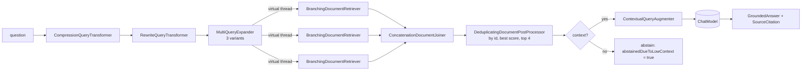
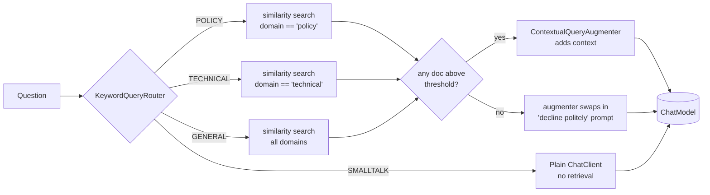

# Blueprint 03: Modular, branching, conditional RAG (Tika/PDF ingestion, pgvector)

**Status:** done (Docling and Arconia substituted, see below) · **Handbook:** Part III, Blueprint 3 · 35 offline tests

This module contains two RAG pipelines.

1. **Handbook pipeline, `/api/v1/rag/*`** (package `handbook`). It ingests PDF, Word, PowerPoint and
   Markdown idempotently and attaches domain and date metadata. Before retrieval it compresses,
   rewrites and expands each question into 3 queries, which run in parallel on virtual threads. A
   branching retriever then searches the ARCHITECTURE, SECURITY_POLICY or RUNBOOKS partition with a
   similarity floor. Results are de-duplicated by document id. The answer is a `GroundedAnswer` with
   citations (file, section, page), or an explicit abstention.
2. **The first pipeline, `/api/ask`.** It has a keyword router, domain-filtered retrieval and a
   decline-when-empty augmenter. It predates the PDF check and is kept because the TOON measurement uses it.

## 1. Handbook pipeline



| Handbook item | Where / status |
|---|---|
| `DocumentIngestionService` for PDF, Markdown and Office files | `handbook/DocumentIngestionService`. PDFs are read page by page (`PagePdfDocumentReader`, so citations carry page numbers), Office/HTML files go through Apache Tika (`TikaDocumentReader`), Markdown is split by heading. **Docling is substituted**: it needs a separate Python service. The old `DoclingStubParser` is still there. |
| metadata `domain_category`, `effective_date`, plus summary and keyword enrichers | Every chunk gets `filename`, `domain_category`, `effective_date`, `content_hash`, `section`, `page` and `chunk_index`, then `SummaryMetadataEnricher` and `KeywordMetadataEnricher` run (`section_summary`, `excerpt_keywords`) |
| `POST /api/v1/rag/ingest`, idempotent by content hash | multipart `file`, `domainCategory`, `effectiveDate`. Returns `NEW`, `UNCHANGED` (same SHA-256, nothing embedded) or `REPLACED` (old chunks deleted). Chunk ids are derived from the hash. |
| pre-retrieval: compression, rewrite, multi-query (3) in parallel | `HandbookRagService` on `RetrievalAugmentationAdvisor` with a virtual-thread `SimpleAsyncTaskExecutor` |
| `BranchingDocumentRetriever` over ARCHITECTURE / SECURITY_POLICY / RUNBOOKS, threshold ≥ 0.76 | `DomainCategory` keyword classifier and a filter on `domain_category`. The threshold defaults to **0.76 with real embeddings** and **0.25 with the offline stub embeddings** (bag-of-words cosine scores are lower). Override it with `RAG_HANDBOOK_THRESHOLD`. |
| post-retrieval de-duplication by doc id | `DeduplicatingDocumentPostProcessor` |
| `GroundedAnswer(answerMarkdown, List<SourceCitation>, abstainedDueToLowContext)` | `POST /api/v1/rag/query {"question": ...}`. Citations come from the retrieval metadata, not from the model. |
| tests with `RelevancyEvaluator` and `FactCheckingEvaluator` | `HandbookRagPipelineTest` runs Spring AI's two evaluators (through `pillar-eval-gates`) with the offline lexical judge |
| Micrometer vector-search latency | timer `rag.vector.search{domain_category}` at `/actuator/metrics/rag.vector.search` |
| `/actuator/health/aiEnvironment` | chat model, embedding model, vector store (a live probe search), Presidio, MCP |
| pgvector + Ollama via Arconia dev services / Testcontainers | **substituted**. `src/it/.../PgVectorRagIT` (run with `-Pit`) connects to an existing pgvector database (`docker-compose.ai-support.yml`) and Ollama through environment variables. Arconia dev services and Testcontainers need Docker, which the build machine doesn't have, so they were **not run**. |

Offline, the LLM steps use `HandbookDemoModel`. It is a deterministic, *extractive* stand-in that
answers each `TASK:` prompt and quotes the context sentences that best match the question. It shows
the plumbing without a model, so don't judge answer quality by it. The corpus is in
`src/main/resources/handbook-corpus/<CATEGORY>/`.

```bash
curl -F file=@my-runbook.pdf -F domainCategory=RUNBOOKS -F effectiveDate=2026-10-01 http://localhost:8083/api/v1/rag/ingest
curl -H 'Content-Type: application/json' -d '{"question":"How do I recover from Kafka consumer lag?"}' http://localhost:8083/api/v1/rag/query
```

## 2. First pipeline (`/api/ask`)

A RAG service built from Spring AI's modular RAG parts. A **router** sends each question down a
branch. A **domain-filtered retriever** searches only the matching part of the corpus. A
**conditional augmenter** makes the model decline when nothing relevant is found, instead of
making something up. Production storage is **pgvector**. Tests use an in-memory `SimpleVectorStore`
with deterministic stub embeddings. The module also contains a **measured TOON-vs-JSON token comparison**.



Ingestion (ETL): `corpus/<domain>/*.md` → `MarkdownSectionParser` (or `DoclingStubParser` for `.pdf`/`.docx`)
→ adds `domain`, `source` and `section` metadata → `VectorStore.add`.

## What's here
| Path | Purpose |
|---|---|
| [theory.md](theory.md) | Modular RAG, branching vs conditional, TOON with **measured** numbers |
| [examples/](examples) | curl walkthrough, swapping in pgvector + Ollama |
| [exercises.md](exercises.md) | Practice tasks |
| `routing/` | `QueryIntent`, `QueryRouter`, `KeywordQueryRouter`, `RoutingDocumentRetriever` |
| `ingest/` | `DocumentParser`, `MarkdownSectionParser`, `DoclingStubParser`, `IngestionService` |
| `ModularRagService` | Puts it together with `RetrievalAugmentationAdvisor` |
| `toon/` | `ToonEncoder` (subset of TOON), `TokenCounter` (JTokkit BPE) |
| `web/AskController` | `POST /api/ask` → `{answer, intent, sources}` |
| `src/main/resources/corpus/` | Sample policy and technical documents (synthetic) |
| `src/it/java/.../PgVectorRagIT` | Live pgvector + Ollama `nomic-embed-text` (`-Pit`) |

## First-pipeline tests (21, offline)
- `KeywordQueryRouterTest` (7): one per branch.
- `IngestionServiceTest` (5): section splitting, metadata, Docling stub path, unsupported types, the classpath corpus, and ingesting from a packaged jar (directory entries are skipped).
- `ModularRagServiceTest` (4):
  - policy questions are grounded **only** in policy docs, and technical questions only in technical docs;
  - smalltalk never retrieves;
  - an off-topic question gets no sources, and the raw query never reaches the model.
- `ToonEncoderTest` (3): exact TOON output.
- `ToonVsJsonTokenMeasurementTest` (1): real token counts; the results are in [theory.md](theory.md#toon-measured).
- `ModularRagApplicationTest` (1): full app, corpus ingested at start-up, real HTTP call.

## Run
```bash
mvn -B -pl blueprint-03-modular-rag -am verify          # offline
mvn -pl blueprint-03-modular-rag -am spring-boot:run    # port 8083, stub model
# live pgvector + Ollama (Postgres on 15432, pgvector extension available):
$env:PGPASSWORD = Read-Host "Postgres password"          # PowerShell, session only
mvn -B -Pit verify -pl blueprint-03-modular-rag -am
```

## Assumptions and limits *(author's design, not from handbook)*
- **Docling is stubbed.** Real Docling is a Python service. `DoclingStubParser` takes text that has
  already been converted to Markdown, so the pipeline shape stays the same. A real docling-serve
  HTTP client is planned.
- The keyword router is deliberately simple and deterministic. Exercise 2 adds an LLM fallback.
- The similarity threshold of 0.2 is tuned for the stub bag-of-words embeddings. The IT uses 0.3
  with `nomic-embed-text`; tune it on real data.
- The pgvector IT hasn't been run yet. It needs Postgres with pgvector and Ollama on the user's PC.
