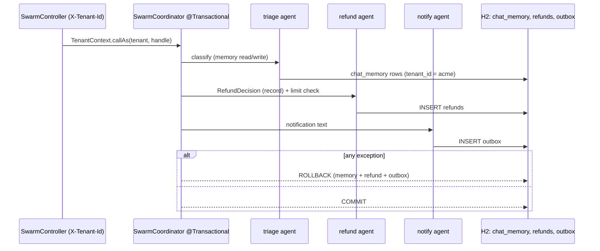

# Blueprint 04: Multi-agent transactional swarm with tenant-partitioned ChatMemory

**Status:** done · **Handbook:** Part III, Blueprint 4

Three agents share one conversation memory and handle a customer request:
- **triage** routes it;
- **refund** decides the refund and writes the refund row;
- **notify** writes an outbox message.

They all run inside **one `@Transactional` boundary**. If any agent or business rule fails, the
refund row, the outbox message **and the chat memory** roll back together. The memory is stored in
the same database (H2 offline, Postgres in production), **partitioned by tenant**.



## What's here
| Path | Purpose |
|---|---|
| [theory.md](theory.md) | Unified data and transactions, outbox, tenant isolation |
| [examples/](examples) | curl calls, reusing the memory repository |
| [exercises.md](exercises.md) | Practice tasks |
| `memory/TenantContext` | Thread-bound tenant; fails closed |
| `memory/TenantJdbcChatMemoryRepository` | Spring AI `ChatMemoryRepository` with `WHERE tenant_id = ?` on every query |
| `agents/SwarmAgents` | The three agents (`MessageChatMemoryAdvisor`, structured `RefundDecision`) |
| `SwarmCoordinator` | The `@Transactional` swarm |
| `schema.sql` | `chat_memory` (PK tenant, conversation, seq), `refunds`, `outbox` |

## Tests: refund swarm (8, offline, real Spring transaction proxy on H2)
- The happy path commits a refund, an outbox row and 6 memory rows.
- **A notifier failure rolls back** the refund row and the triage and refund memory, even though they had already been written.
- **A refund-limit violation rolls back** everything.
- The non-refund route writes only memory.
- **The same conversation id under two tenants gets separate histories**, and the model acting for one tenant never sees the other's messages.
- Memory carries across turns within a tenant.
- No tenant fails closed, and invalid tenant ids are rejected.
- The HTTP endpoint takes the tenant from its header.

## Run
```bash
mvn -B -pl blueprint-04-transactional-swarm -am verify
mvn -pl blueprint-04-transactional-swarm -am spring-boot:run     # port 8084
```

## Handbook build: commerce swarm (`swarm/commerce`)
Part III, Blueprint 4 asks for an Orchestrator & Agent Handoff swarm over one transactional + vector
data plane. It lives in the `commerce` package next to the refund swarm above and runs offline with
`DemoCommerceModel`, a deterministic stand-in for the chat model.

| Handbook requirement (p.10–11) | Where | Status |
|---|---|---|
| `AgentOrchestratorService` with dynamic handoffs | `commerce/AgentOrchestratorService` (records `Handoff`, `SwarmReply`) | Done |
| `TriageRouterAgent`, Routing pattern, keeps tenant and session state | `agents/TriageRouterAgent` (structured `TriageDecision`) | Done |
| `ProductDiscoveryAgent` with hybrid vector search | `agents/ProductDiscoveryAgent`: vector and SQL keyword results fused with RRF (k = 60), filtered by tenant | Done |
| `OrderExecutionAgent`: `@Tool` methods over `@Transactional` Spring Data repositories (inventory, pricing, order) | `agents/OrderTools` (`placeOrder`, `orderStatus`) and `domain/CommerceRepositories` (Spring Data JDBC, optimistic `@Version` on stock) | Done (Spring Data JDBC, not JPA) |
| `RefundAndDisputeAgent`: needs the user id and an `orderItemId` the user owns, plus an evaluator-optimizer loop before writing | `agents/RefundAndDisputeAgent` and `RefundPolicy`: up to 3 propose/evaluate rounds, then escalate; the write is in a `TransactionTemplate` | Done |
| `TenantPartitionedChatMemory implements ChatMemory`, `TenantSessionKey(tenantId, userId, sessionId)`, sliding-window compaction | `memory/TenantPartitionedChatMemory` (JDBC, fails closed on a foreign tenant, folds old turns into one summary message) | Done |
| `POST /api/v1/swarm/chat`, SSE streaming, `GET /api/v1/swarm/sessions/{id}/history` | `web/SwarmChatController` (`/chat`, `/chat/stream`, `/sessions/{id}/history`) | Done |
| Handoff badges shown live | `static/swarm.html` (reads the SSE stream) at http://localhost:8084/swarm.html | Done |
| Cosmos DB DiskANN or PostgreSQL + PGVector | `SimpleVectorStore` with stub embeddings offline. PGVector is in the support compose file but not wired in this module | Substituted (no Azure account; offline-first) |
| Integration tests | `CommerceSwarmApiTest` (11) and `TenantPartitionedChatMemoryTest` (2) | Done (offline; no live-model run) |

Commerce tests cover:
- hybrid search staying inside one tenant;
- an order placed through a real tool call;
- an out-of-stock order writing nothing;
- **a failure after the stock update rolling the stock back** (a real `@Transactional` proxy);
- order status limited to the customer's own orders;
- a refund corrected by the evaluator loop (the first proposal adds GST and is rejected) and then persisted;
- a refund outside the window being denied, and a refund for an item the user doesn't own being refused;
- history partitioned by tenant, user and session;
- the SSE stream sending the handoff before the reply;
- the badge page being served;
- memory refusing another tenant's conversation.

```bash
curl -s localhost:8084/api/v1/swarm/chat -H 'Content-Type: application/json' \
  -d '{"tenantId":"acme","userId":"u-asha","sessionId":"s-1","message":"Please order 2 of SKU-MSE-04"}'
```

## Assumptions *(author's design, not from handbook)*
- The demo takes the tenant from the `X-Tenant-Id` header. **In production it must come from the
  authenticated principal** (for example, a JWT claim).
- The agents run sequentially inside one transaction. Model calls inside a DB transaction hold a
  connection for seconds, which is acceptable for a demo. At scale, run the model calls first and
  then commit memory and business rows in a short transaction (exercise 3).
