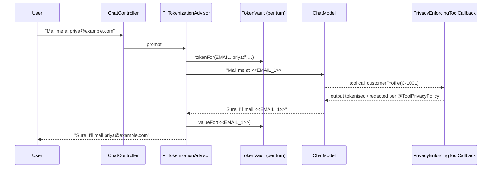

# Blueprint 05: Zero-trust PII tokenisation advisor with `@ToolPrivacyPolicy`

**Status:** done · **Handbook:** Part III, Blueprint 5

A Spring Boot app where **raw personal data never reaches the model**. A Spring AI `CallAdvisor`
replaces PII with opaque tokens (`<<EMAIL_1>>`) before the call. The model reasons over the tokens,
and the advisor swaps the real values back in before the answer reaches the user. Tool outputs are
governed per method by `@ToolPrivacyPolicy` (TOKENIZE / REDACT / ALLOW_RAW).



## What's here
| Path | Purpose |
|---|---|
| [theory.md](theory.md) | Threat model, design choices, limits |
| [examples/](examples) | `curl` walkthrough and standalone snippet |
| [exercises.md](exercises.md) | Practice tasks |
| `src/main/.../core` | `PiiType` (email, PAN, card+Luhn, Aadhaar, Indian phone), `TokenVault`, `PiiTokenizer` |
| `src/main/.../advisor/PiiTokenizationAdvisor.java` | The zero-trust advisor |
| `src/main/.../tools` | `@ToolPrivacyPolicy`, `PrivacyEnforcingToolCallback`, demo `CustomerTools` |
| `src/main/.../web/ChatController.java` | `POST /api/chat` |
| `src/test/...` | 18 offline tests (see below) |
| `src/it/java/.../OllamaPiiIT.java` | Live test against Ollama (`-Pit`) |

## Tests that prove the guarantee
- `PiiTokenizationAdvisorTest`: the `StubChatModel` records every prompt. The tests assert the email
  and phone number are **absent** from everything sent, the tokens are present, and the user still gets the real values back.
  A second test shows advisors that run later (such as loggers) only see tokens.
- `ToolPrivacyPolicyTest`: each annotation mode is enforced on real Spring AI `ToolCallback`s.
- `PiiTokenizerTest`: detection and round trip for each PII type, plus false-positive checks.
- `PiiAdvisorApplicationTest`: full Spring context, a real HTTP call, and a check that PII is absent from the model input.

## Run
```bash
mvn -B -pl blueprint-05-pii-tokenization-advisor -am verify      # offline
mvn -pl blueprint-05-pii-tokenization-advisor -am spring-boot:run   # stub model, port 8085
# live with Ollama (see docs/setup.md):
BLUEPRINTS_MODEL=ollama mvn -Pit -pl blueprint-05-pii-tokenization-advisor -am spring-boot:run
```

## Assumptions *(author's design, not from handbook)*
- The vault is in memory and lasts one conversation turn. Production would use an encrypted, TTL'd store.
- Detection is regex-based, for Indian formats plus email and cards. Names and addresses are **not**
  detected. Add an NER model for those.
