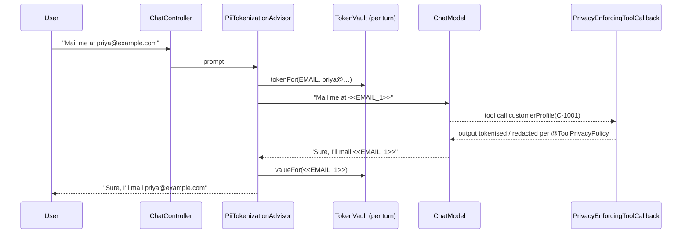

# Blueprint 05: Zero-trust PII tokenisation advisor with `@ToolPrivacyPolicy`

**Status:** done · **Handbook:** Part III, Blueprint 5

A Spring Boot app where **raw personal data never reaches the model**. A Spring AI `CallAdvisor`
replaces PII with opaque tokens (`<<EMAIL_1>>`) before the call. The model reasons over the tokens,
and the advisor swaps the real values back in before the answer reaches the user. Tool outputs are
governed per method by `@ToolPrivacyPolicy` (TOKENIZE / REDACT / ALLOW_RAW).



## What's here
| Path | Purpose |
|---|---|
| [theory.md](theory.md) | Threat model, design choices, limits |
| [examples/](examples) | `curl` walkthrough and standalone snippet |
| [exercises.md](exercises.md) | Practice tasks |
| `src/main/.../core` | `PiiType` (email, PAN, card+Luhn, Aadhaar, Indian phone), `TokenVault`, `PiiTokenizer` |
| `src/main/.../advisor/PiiTokenizationAdvisor.java` | The zero-trust advisor |
| `src/main/.../FinOpsConfiguration.java` | Wires `pillar-finops-budget`'s `FinOpsBudgetAdvisor` behind the PII advisor in `PrivacyChatService`, so the budget is reserved on the tokenized prompt (`blueprint.finops.tenant-token-limit`, default 200000) |
| `src/main/.../tools` | `@ToolPrivacyPolicy`, `PrivacyEnforcingToolCallback`, demo `CustomerTools` |
| `src/main/.../web/ChatController.java` | `POST /api/chat` |
| `src/test/...` | 18 offline tests (see below) |
| `src/it/java/.../OllamaPiiIT.java` | Live test against Ollama (`-Pit`) |

## Tests that prove the guarantee
- `PiiTokenizationAdvisorTest`: the `StubChatModel` records every prompt. The tests assert the email
  and phone number are **absent** from everything sent, the tokens are present, and the user still gets the real values back.
  A second test shows advisors that run later (such as loggers) only see tokens.
- `ToolPrivacyPolicyTest`: each annotation mode is enforced on real Spring AI `ToolCallback`s.
- `PiiTokenizerTest`: detection and round trip for each PII type, plus false-positive checks.
- `PiiAdvisorApplicationTest`: full Spring context, a real HTTP call, and a check that PII is absent from the model input.

## Run
```bash
mvn -B -pl blueprint-05-pii-tokenization-advisor -am verify      # offline
mvn -pl blueprint-05-pii-tokenization-advisor -am spring-boot:run   # stub model, port 8085
# live with Ollama (see docs/setup.md):
BLUEPRINTS_MODEL=ollama mvn -Pit -pl blueprint-05-pii-tokenization-advisor -am spring-boot:run
```

## Handbook build: guardrails package (`pii/guardrails`)
Part III, Blueprint 5 (pp. 11–12) asks for request-scoped reversible tokenisation with
least-privilege disclosure at tool boundaries. That design is in `guardrails`, next to the first
version above (`<<EMAIL_1>>` tokens, output-only tool policy), which still works and is still tested.

| Handbook requirement | Where | Status |
|---|---|---|
| Pluggable `PiiAnalyzerSpi`; composite of regex recognizers (email, phone, card, SSN/PAN, IBAN) | `detect/PiiAnalyzerSpi`, `RegexPiiAnalyzer` (Luhn for cards, mod-97 for IBAN, account numbers only after an "account"/"a/c" keyword), `CompositePiiAnalyzer` (longest span wins, ignores existing placeholders) | Done |
| JVM-local Apache OpenNLP NER for Person/Location | `detect/OpenNlpPiiAnalyzer`: OpenNLP `DictionaryNameFinder` over bundled gazetteers. It also runs `NameFinderME` when `OPENNLP_PERSON_MODEL` / `OPENNLP_LOCATION_MODEL` point at model files | Partial: the statistical models are not bundled (they are not on Maven Central) and were not run here. The dictionary only finds listed names |
| Optional Microsoft Presidio analyzer | `detect/PresidioPiiAnalyzer`, which joins when `PRESIDIO_ANALYZER_URL` is set. It fails closed if Presidio is down | Done as a client, tested against a local HTTP stub. Not run against a real Presidio container (there is no Docker on the build box) |
| Request-scoped `PrivacyTokenVault`, deterministic `<PII:EMAIL_1>`, `<PII:ACCOUNT_1>` | `vault/PrivacyTokenVault`, `PrivacySession` (one per request) | Done |
| Final-response policies `DETOKENIZE_FOR_AUTHORIZED_USER`, `REDACT`, `BLOCK_ON_LEAK` | `vault/ResponsePolicy`, applied in the advisor. Detokenising needs `ROLE_PII_VIEWER` (`blueprints.privacy.detokenize-authority`) | Done |
| `PrivacyProtectionCallAdvisor implements CallAdvisor` sanitising user and system messages and RAG documents | `advisor/PrivacyProtectionCallAdvisor`. It also covers assistant tool-call arguments, tool responses and the `rag_document_context` documents, runs inner to the RAG and tool-calling advisors so it sees every model call, and fails closed without a session | Done |
| ChatMemory boundary | Memory messages pass through the same advisor when the memory advisor is ordered before it | Partial: there is no memory advisor in the demo pipeline |
| `@ToolPrivacyPolicy(allowedPiiTypes, requiredRole)` | `tools/ToolPrivacyPolicy`, `ToolPolicyRegistry` | Done |
| (a) unauthorized tools left out of the schema by Spring Security `Authentication` (b) selective restore of arguments (c) tool output re-tokenised | `tools/PrivacyToolGuard`, `GuardedToolCallback` (also re-checks the role at call time). Raw values the vault already knows are re-tokenised even when no detector fires | Done |
| Same protection for MCP tools | `ToolPolicyRegistry.register(name, policy)` for plain `ToolCallback`s such as MCP client callbacks. Tested with a `FunctionToolCallback` standing in for one | Partial: no live MCP server is used in this module |
| `POST /api/v1/privacy/inspect-roundtrip` with a deterministic test ChatModel, structured audit proving zero raw PII crossed the boundary | `inspect/PrivacyInspectorController`, `PrivacyInspectorService`, `InspectorChatModel`, `InspectionReport.BoundaryVerdict` | Done. The verdict only covers PII that some analyzer recognises |
| Spring Security integration | Uses `spring-security-core` `Authentication`. The inspector builds a simulated caller from `simulatedRoles`, otherwise it reads the `SecurityContext` | Partial: no HTTP authentication filter chain is configured in this demo |

### What the inspector shows (real output, offline jar)
```bash
curl -s localhost:8085/api/v1/privacy/inspect-roundtrip -H 'Content-Type: application/json' \
  -d '{"message":"Customer Priya Sharma asks for the balance of account 123456789012","simulatedRoles":["ROLE_COMPLIANCE_AGENT"]}'
```
Abridged:
```text
toolsOfferedToLlm   [accountBalance, branchHours]      toolsHiddenFromLlm [customerContact]
LLM saw             USER: Customer <PII:PERSON_1> asks for the balance of account <PII:ACCOUNT_1>
tool got            {"accountNumber":"123456789012"}   (restoredTypes [ACCOUNT_NUMBER])
tool result to LLM  Account <PII:ACCOUNT_1>: holder <PII:PERSON_1>, <PII:EMAIL_1>, balance INR 1,20,000.00
finalOutput         Result: "Account [REDACTED_ACCOUNT]: holder [REDACTED_PERSON], [REDACTED_EMAIL], ..."
verdict             protectedValues 3, modelCalls 2, zeroRawPiiCrossedLlmBoundary true
```
The caller has no `ROLE_PII_VIEWER` role, so the answer is redacted. With that role it is detokenised.

### Guardrails tests (14, offline)
- `PiiAnalyzersTest` (4): checksums and context for the regex recognizers; OpenNLP persons and locations; composite overlap handling; the Presidio client's mapping, score filter and fail-closed behaviour.
- `PrivacyBoundaryUnitTest` (3):
  - deterministic placeholders and selective restore;
  - an MCP-style tool getting only its allowed type, with its output re-tokenised and the tool hidden from another role;
  - the advisor failing closed without a session.
- `PrivacyInspectorApiTest` (7):
  - the compliance-agent round trip;
  - detokenising for a viewer;
  - no role, so no tool;
  - RAG documents tokenised (IBAN, SSN, email, person, location);
  - `BLOCK_ON_LEAK`;
  - `REDACT` for a viewer;
  - the `aiEnvironment` health check reporting the Presidio probe.

## Assumptions *(author's design, not from handbook)*
- The vault is in memory and lasts one conversation turn. Production would use an encrypted, TTL'd store.
- Detection is regex-based, for Indian formats plus email and cards. Names and addresses are **not**
  detected. Add an NER model for those.
