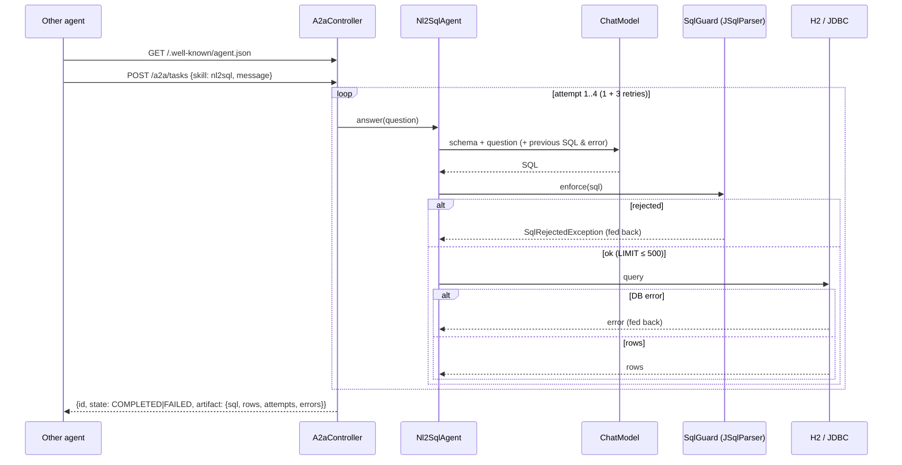

# Blueprint 07: A2A mesh + self-healing NL2SQL agent

**Status:** done (A2A-style, single agent) · **Handbook:** Part III, Blueprint 7

An agent that turns questions into SQL and can be called by other agents. Every query the model
writes passes a **JSqlParser guard**:
- only one read-only `SELECT`;
- only allow-listed tables;
- **`LIMIT 500`** added if missing, and capped if larger.

When the guard or the database rejects the SQL, the error goes back to the model for up to
**3 self-healing retries**, so at most 4 model calls in total. Offline it runs on **H2** with stub models.



## What's here
| Path | Purpose |
|---|---|
| [theory.md](theory.md) | Why parse instead of regex, the defence layers, the retry loop, A2A |
| [examples/](examples) | curl calls, embedding the agent |
| [exercises.md](exercises.md) | Practice tasks |
| `guard/SqlGuard` | JSqlParser 5.4 validation and LIMIT enforcement |
| `agent/Nl2SqlAgent`, `Nl2SqlResult` | Self-healing loop |
| `a2a/` | `AgentCard`, `A2aTask`, `A2aController` (A2A-style endpoints) |
| `resources/schema.sql`, `data.sql` | Synthetic `customers` and `orders` tables (606 orders, to prove the limit) |

## Tests (22, offline)
- `SqlGuardTest` (15):
  - 11 rejected inputs: DELETE, UPDATE, DROP, INSERT, TRUNCATE, CREATE, stacked statements, system tables, FOR UPDATE, a parse error, empty;
  - LIMIT is added, capped, or a smaller one kept;
  - joins and UNION are allowed;
  - rejection messages are useful to the model.
- `Nl2SqlAgentTest` (5):
  - first-try success;
  - self-heals from an H2 error, and the retry prompt contains the failing SQL and the error;
  - self-heals from a guard rejection, with no rows deleted;
  - **gives up after exactly 4 model calls**;
  - `SELECT * FROM orders` returns exactly 500 of 606 rows.
- `A2aEndpointTest` (2): the agent card is discoverable, and a task runs over real HTTP.

## Run
```bash
mvn -B -pl blueprint-07-a2a-nl2sql-agent -am verify
mvn -pl blueprint-07-a2a-nl2sql-agent -am spring-boot:run      # port 8087, H2, stub model
```
With the default echo stub, the "SQL" is just your question, so the guard rejects it. That shows
the retry loop working. Use a real model (exercise 4) for meaningful SQL.

## Assumptions and limits *(author's design, not from handbook)*
- **"A2A-style", not the official A2A SDK.** The agent card and task endpoints follow the A2A
  idea (discovery plus tasks), simplified to synchronous JSON. A full A2A mesh with several agents is planned.
- "3 retries" is read as 1 initial attempt + 3 retries, so at most 4 model calls.
- Defence in depth: the guard, plus `JdbcTemplate.setMaxRows(500)` and a 10 s query timeout. In
  production, also connect with a read-only database user.
