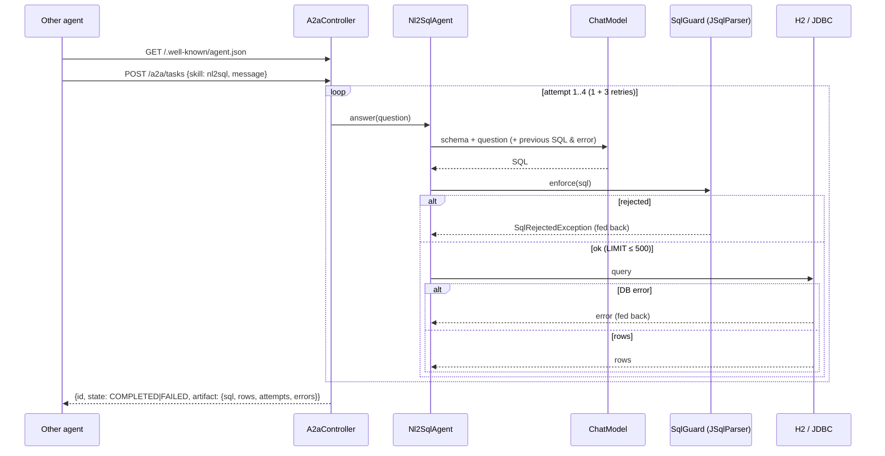

# Blueprint 07: A2A mesh + self-healing NL2SQL agent

**Status:** done (A2A-style, single agent) · **Handbook:** Part III, Blueprint 7

An agent that turns questions into SQL and can be called by other agents. Every query the model
writes passes a **JSqlParser guard**:
- only one read-only `SELECT`;
- only allow-listed tables;
- **`LIMIT 500`** added if missing, and capped if larger.

When the guard or the database rejects the SQL, the error goes back to the model for up to
**3 self-healing retries**, so at most 4 model calls in total. Offline it runs on **H2** with stub models.



## What's here
| Path | Purpose |
|---|---|
| [theory.md](theory.md) | Why parse instead of regex, the defence layers, the retry loop, A2A |
| [examples/](examples) | curl calls, embedding the agent |
| [exercises.md](exercises.md) | Practice tasks |
| `guard/SqlGuard` | JSqlParser 5.4 validation and LIMIT enforcement |
| `agent/Nl2SqlAgent`, `Nl2SqlResult` | Self-healing loop |
| `a2a/` | `AgentCard`, `A2aTask`, `A2aController` (A2A-style endpoints) |
| `resources/schema.sql`, `data.sql` | Synthetic `customers` and `orders` tables (606 orders, to prove the limit) |

## Tests (22, offline)
- `SqlGuardTest` (15):
  - 11 rejected inputs: DELETE, UPDATE, DROP, INSERT, TRUNCATE, CREATE, stacked statements, system tables, FOR UPDATE, a parse error, empty;
  - LIMIT is added, capped, or a smaller one kept;
  - joins and UNION are allowed;
  - rejection messages are useful to the model.
- `Nl2SqlAgentTest` (5):
  - first-try success;
  - self-heals from an H2 error, and the retry prompt contains the failing SQL and the error;
  - self-heals from a guard rejection, with no rows deleted;
  - **gives up after exactly 4 model calls**;
  - `SELECT * FROM orders` returns exactly 500 of 606 rows.
- `A2aEndpointTest` (2): the agent card is discoverable, and a task runs over real HTTP.

## Run
```bash
mvn -B -pl blueprint-07-a2a-nl2sql-agent -am verify
mvn -pl blueprint-07-a2a-nl2sql-agent -am spring-boot:run      # port 8087, H2, stub model
```
With the default echo stub, the "SQL" is just your question, so the guard rejects it. That shows
the retry loop working. Use a real model (exercise 4) for meaningful SQL.

## Handbook build: DataAgent and A2A mesh (`workflow/`, `dataagent/`, `mesh/`)
Part III, Blueprint 7 (pp. 13–14). The first-cut agent above (`/a2a/tasks`, `SqlGuard`) still works.
The handbook design sits next to it and runs offline with `DataAgentDemoModel`, a scripted SQL
writer that makes the mistakes the loop has to repair.

| Handbook requirement | Where | Status |
|---|---|---|
| `SequentialAgent`, `ParallelAgent`, `LoopAgent` with context compaction and a tool-call loop guard | `workflow/` (`WorkflowContext` with tool-call budget, `ContextCompactor` with chars/4 estimate and a pluggable summarizer, parallel branches on virtual threads with a timeout) | Done |
| `SchemaVectorIndexer`: `DatabaseMetaData` tables, columns, FKs and enum samples into a vector store; only top-K tables in the prompt | `dataagent/SchemaVectorIndexer` (top-K plus FK neighbours so joins stay possible) on `SimpleVectorStore` with stub embeddings | Done (offline embeddings) |
| `SqlAstGuardrailValidator`: JSqlParser, read-only SELECT, mandatory `tenant_id = :tenantId`, LIMIT ≤ 500 | `dataagent/SqlAstGuardrailValidator`. It also rejects CTEs, UNION, subqueries and any model-written `tenant_id` | Done |
| `SelfHealingSqlLoopAgent`: read-only `JdbcClient`; error and explain plan fed back on a `DataAccessException` or an empty join; at most 3 retries | `dataagent/SelfHealingSqlLoopAgent`: EXPLAIN plus cost check (refuses a full scan of a table above `max-full-scan-rows`); execution in a read-only, rolled-back transaction | Done |
| `ExecutiveInsightSynthesizer` → `DataAnalysisReport(naturalLanguageSummary, executedSql, rows, suggestedChart)` with `ChartSpecification` | `dataagent/ExecutiveInsightSynthesizer`. The summary is computed from the rows, not generated | Done |
| Agent cards (intents, input/output schemas, SLA metrics) in Nacos / Spring Cloud Discovery | `mesh/MeshAgentCard`, `SlaTracker` (live p95 and success rate), `AgentRegistry` → `LocalAgentRegistry` (TTL heartbeat). The agent registers itself once its port is known | Substituted: an in-process registry behind an interface. Nacos is in the support compose file but not wired (no Nacos client in the build) |
| A2A protocol between agents | `mesh/A2aJsonRpcController`: JSON-RPC 2.0 `message/send` → `Task` with a data artifact at `POST /a2a`, card at `/.well-known/agent-card.json` | Partial: only `message/send`, with no streaming, `tasks/get` or push notifications |
| JManus-style coordination | `mesh/MeshCoordinator`: discover by intent, then a parallel A2A fan-out, `POST /api/v1/mesh/research` | Done (single-process demo; the HTTP calls are real) |
| Testcontainers PostgreSQL tests: (a) multi-join aggregation (b) a column typo self-heals (c) DROP TABLE blocked before JDBC | `DataAgentApiTest` runs all three cases, plus an empty-join repair, a cross-tenant attempt and a time series, on **H2** | Partial: the scenarios are tested, but not on PostgreSQL. There is no Docker on the build box, and no Testcontainers PostgreSQL test was written |
| Spring AI Alibaba | Not used | Substituted: the patterns are built on plain Spring AI 2.0.1 |

Real numbers from the tests (tenant `acme`):
- "top customers by revenue in Chennai" gives Asha Rao at 15,296 INR.
- "revenue by product category" fails on the first try with `Column "P.CATEGRY" not found` and is repaired on the second, giving PERIPHERALS at 28,191 INR.
- The prompt-injected `DROP TABLE` is rejected 4 times out of 4, and 0 JDBC calls are made.

```bash
curl -s localhost:8087/api/v1/data-agent/ask -H 'X-Tenant-Id: acme' -H 'Content-Type: application/json' \
  -d '{"question":"What is the revenue by product category?"}'
```

Tests: 36 in total, all offline:
- `DataAgentApiTest` (8);
- `SqlAstGuardrailValidatorTest` (2, covering 13 hostile statements);
- `WorkflowPrimitivesTest` (4);
- the 22 earlier tests.

## Assumptions and limits *(author's design, not from handbook)*
- **"A2A-style", not the official A2A SDK.** The agent card and task endpoints follow the A2A
  idea (discovery plus tasks), simplified to synchronous JSON. A full A2A mesh with several agents is planned.
- "3 retries" is read as 1 initial attempt + 3 retries, so at most 4 model calls.
- Defence in depth: the guard, plus `JdbcTemplate.setMaxRows(500)` and a 10 s query timeout. In
  production, also connect with a read-only database user.
