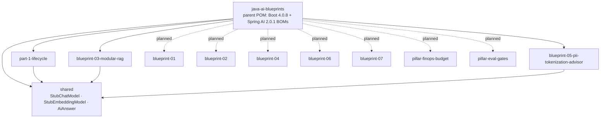
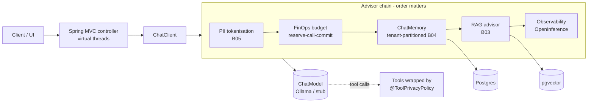
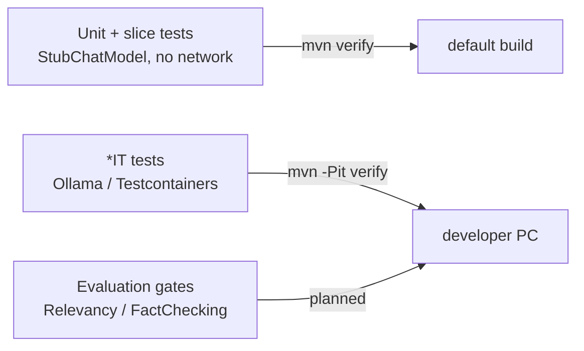

# Architecture

*(author's design, not from handbook; it follows the handbook's pillars)*

## Repository / module graph

## Target runtime architecture (all blueprints)

## Test layers (dual-layer verification)

## Key decisions
| Decision | Reason |
|---|---|
| Stub models in `shared/` | Deterministic tests that can prove what was or wasn't sent to a model |
| Advisors for cross-cutting AI concerns | One enforcement point; business code can't bypass it |
| PII advisor at `HIGHEST_PRECEDENCE` | Every later advisor, log and model sees only tokens |
| `*IT` under `-Pit` + `src/it/java` | Default build needs no Docker or Ollama; IT sources need the Ollama starter only in that profile |
| pgvector over Cosmos DB | Free, local, and one database for vectors and business data |
