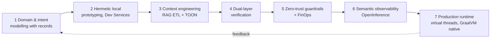

# Theory: J-AIDLC, the five pillars and the framework matrix

Source: handbook Part I (from reading notes; see [mapping](../docs/pdf-requirements-mapping.md)).
The stage and pillar names come from the handbook. The explanations are **author's design (not from handbook)**
unless stated otherwise.

## J-AIDLC: Java AI Development Lifecycle (7 stages)

| # | Stage | What it means in practice | In this repo |
|---|---|---|---|
| 1 | Domain/intent modelling with records | Write the model's input and output as Java records first. The model has to fill a typed contract. | `IncidentTriage`, `StructuredOutputExample` |
| 2 | Hermetic local prototyping with Dev Services | Run local infrastructure (Ollama, Postgres) with Testcontainers or Arconia Dev Services. No cloud. | stub models now; `-Pit` profile |
| 3 | Context engineering & RAG ETL with TOON | Ingest, chunk, embed and retrieve. Serialise context compactly (TOON, Token-Oriented Object Notation). | Blueprint 03 |
| 4 | Dual-layer verification | Layer 1: deterministic tests with stub models. Layer 2: LLM-as-judge evaluators (relevancy, fact-checking). | stub tests; `pillar-eval-gates` (planned) |
| 5 | Zero-trust guardrails with FinOps | Advisors that tokenise PII, enforce tool policies and reserve a token budget before each call. | Blueprint 05; `pillar-finops-budget` |
| 6 | Semantic observability with OpenInference | Trace prompts, tools and tokens with OpenInference semantic conventions on OpenTelemetry. | planned |
| 7 | Production runtime with virtual threads & GraalVM native | Use virtual threads for blocking LLM I/O, and native images for fast start-up. | `VirtualThreadFanOut`, `spring.threads.virtual.enabled` |

> **TOON caveat:** the handbook says TOON saves 40–50% of tokens. Blueprint 03 measured 38–39% against compact
> JSON on uniform tables, 16% on long-text chunks, and 26–31% *more* tokens on nested data
> (see [Blueprint 03 theory](../blueprint-03-modular-rag/theory.md#toon-measured)).

## Five pillars

| Pillar | Why Java is good at it | Example |
|---|---|---|
| Virtual threads | LLM calls block for seconds. Virtual threads make thread-per-request cheap, with no reactive code needed. | `VirtualThreadFanOut` |
| Records as LLM contracts | Immutable, validated, and they map to a JSON schema for structured output | `IncidentTriage` |
| Advisor API | Spring AI's interceptor chain around every model call: guardrails, memory, RAG, audit | `AuditTrailAdvisor`, `PiiTokenizationAdvisor` |
| Testcontainers / Arconia | Real local Ollama and pgvector in tests and dev, started on demand | `-Pit` profile (planned ITs) |
| Unified data & transactions | Vectors, chat memory and business rows in one Postgres, under one transaction | Blueprint 04 (planned) |

## Framework matrix

The rows are the handbook's five frameworks. The "best for" column is **author's design (not from handbook)**.

| Framework | Style | Best for | Used in |
|---|---|---|---|
| Spring AI 2.0 | Spring-native `ChatClient`, advisors, vector stores, MCP | Most enterprise apps on Spring Boot | all modules |
| LangChain4j | Framework-agnostic AI services, many integrations | Non-Spring or Quarkus apps | — |
| Embabel | Goal-oriented action planning (GOAP) agents on the JVM | Planning agents | Blueprint 01 |
| LangGraph4j | Stateful graphs, checkpoints, human-in-the-loop | Multi-step and HITL workflows | Blueprint 02 |
| Spring AI Alibaba | Alibaba extensions, graph and JManus agent | Alibaba Cloud / Nacos users | catalogue only (Nacos replaced, see version notes) |
