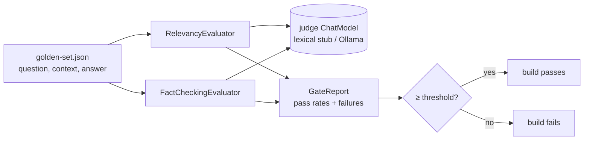

# Part IV pillar: JUnit evaluation gates

**Status:** done · **Handbook:** Part IV, 10.2 (RelevancyEvaluator, FactCheckingEvaluator, json-io TOON)

Evaluation gates are JUnit tests that **fail the build when AI answers stop being relevant or
grounded**, just like a failing unit test. They use Spring AI's `RelevancyEvaluator` and
`FactCheckingEvaluator` over a golden set. The judge model is pluggable:

| Mode | Judge | Gate threshold | Command |
|---|---|---|---|
| Offline (default) | `LexicalJudgeChatModel`: deterministic word-overlap judge | 90% relevancy, 90% facts | `mvn verify` |
| Live | Ollama `llama3.2:3b` (temperature 0) | 60% / 60% (a small model is a noisy judge) | `mvn -Pit verify` |

## What's here
| Path | Purpose |
|---|---|
| [theory.md](theory.md) | Dual-layer verification, judge design, limits of a lexical judge |
| [examples/](examples) | Gating your own module |
| [exercises.md](exercises.md) | Practice tasks |
| `EvaluationGate` | Runs both evaluators; loads golden sets from JSON |
| `LexicalJudgeChatModel` | Deterministic judge that understands both evaluators' prompts |
| `GateReport`, `EvalCase` | Results and golden rows |
| `gates/GateSuite` | Runs named evaluators over a golden set and reports a pass rate per gate |
| `gates/StructuredOutputEvaluator` | Gate 3: answer parses into the target record, no missing fields |
| `gates/PiiLeakEvaluator` | Gate 4: no raw e-mail, Luhn-valid card, SSN, PAN, Aadhaar or phone number in the answer |
| `gates/AnswerTokenBudgetEvaluator` | Gate 5: answer stays under a token ceiling (JTokkit cl100k) |
| `toon/ToonContextSerializer` | json-io TOON serialisation for prompt context, plus a token comparison against Jackson JSON |
| `src/test/resources/golden-set.json` | 5 grounded answers (refunds, leave, Kafka) |
| `src/test/resources/regression-set.json` | 3 bad answers: a wrong number, an invented policy, an off-topic answer |
| `src/it/java/.../OllamaJudgeIT` | Live judge |

## Tests (19, offline)
- `EvaluationGateTest` (10):
  - each golden case passes both evaluators (5);
  - the golden set passes the gate;
  - each regression fails fact-checking (3);
  - **a release whose answers regressed is blocked**: golden plus regressions comes out at 63%, under 90%.
- `LexicalJudgeChatModelTest` (2).
- `VerdictNormalizingChatModelTest` (1): small-judge replies such as "Yes." are reduced to bare YES/NO.
- `FiveGateSuiteTest` (4): the golden set passes groundedness, relevance, PII-leak and answer-budget;
  grounded answers that leak an e-mail or a card number, or ramble, fail the right gate; the structured
  gate accepts fenced JSON and rejects missing fields and prose; a non-Luhn digit run is not flagged.
- `ToonContextSerializerTest` (2): token measurement (below) and a TOON round trip back to maps.

## The five gates
The handbook's cover lists "5 LLM Evaluator Gates", but the body (10.2) names only two. Gates 3-5 are
**author's design (not from handbook)**.

| # | Gate | Source | Judge |
|---|---|---|---|
| 1 | Groundedness / hallucination | Handbook: `FactCheckingEvaluator` | Lexical stub offline, Ollama under `-Pit` |
| 2 | Relevance | Handbook: `RelevancyEvaluator` | Same |
| 3 | Structured output | Author's design | Deterministic |
| 4 | Raw-PII leak | Author's design | Deterministic |
| 5 | Answer token budget | Author's design | Deterministic |

The handbook asks for the judge to run "via Testcontainers Ollama" in CI. Here CI uses the lexical judge,
and the Ollama judge (`OllamaJudgeIT`) needs a local Ollama under `-Pit`. There is no Docker on the
build box, so Testcontainers was not used.

## TOON measurement (json-io 4.117.0, JTokkit cl100k, measured on the build box)
| Payload | Compact Jackson JSON | Pretty JSON | TOON | Saving |
|---|---|---|---|---|
| 40 flat, uniform rows (5 fields) | 1,176 tokens | — | 800 tokens | **32.0%** less than compact JSON |
| 40 nested orders (2 line items each) | 2,217 tokens | 4,136 tokens | 2,256 tokens | 1.8% **more** than compact JSON; 45% less than pretty JSON |

The handbook's "40-50%" holds against pretty-printed JSON, and partly for flat tables. For nested
objects TOON's indentation costs about as much as JSON's punctuation. Use TOON for tabular context
such as query results or catalogues. The test only asserts what was measured. Cyclic references and
generic types were not tested.

Measured on the build box: golden set 100% relevancy and 100% facts; mixed set 63% / 63%, with
exactly the 3 regressions flagged.

**Reused by** Blueprint 02, whose evaluator agent calls `EvaluationGate` on every draft.
