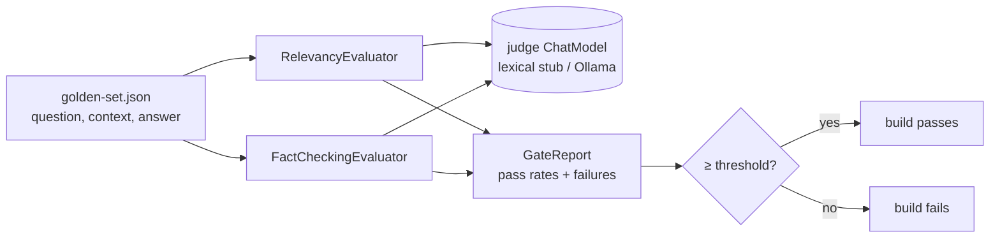

# Part IV pillar: JUnit evaluation gates

**Status:** done · **Handbook:** Part IV (RelevancyEvaluator, FactCheckingEvaluator)

Evaluation gates are JUnit tests that **fail the build when AI answers stop being relevant or
grounded**, just like a failing unit test. They use Spring AI's `RelevancyEvaluator` and
`FactCheckingEvaluator` over a golden set. The judge model is pluggable:

| Mode | Judge | Gate threshold | Command |
|---|---|---|---|
| Offline (default) | `LexicalJudgeChatModel`: deterministic word-overlap judge | 90% relevancy, 90% facts | `mvn verify` |
| Live | Ollama `llama3.2:3b` (temperature 0) | 60% / 60% (a small model is a noisy judge) | `mvn -Pit verify` |

## What's here
| Path | Purpose |
|---|---|
| [theory.md](theory.md) | Dual-layer verification, judge design, limits of a lexical judge |
| [examples/](examples) | Gating your own module |
| [exercises.md](exercises.md) | Practice tasks |
| `EvaluationGate` | Runs both evaluators; loads golden sets from JSON |
| `LexicalJudgeChatModel` | Deterministic judge that understands both evaluators' prompts |
| `GateReport`, `EvalCase` | Results and golden rows |
| `src/test/resources/golden-set.json` | 5 grounded answers (refunds, leave, Kafka) |
| `src/test/resources/regression-set.json` | 3 bad answers: a wrong number, an invented policy, an off-topic answer |
| `src/it/java/.../OllamaJudgeIT` | Live judge |

## Tests (13, offline)
- `EvaluationGateTest` (10):
  - each golden case passes both evaluators (5);
  - the golden set passes the gate;
  - each regression fails fact-checking (3);
  - **a release whose answers regressed is blocked**: golden plus regressions comes out at 63%, under 90%.
- `LexicalJudgeChatModelTest` (2).
- `VerdictNormalizingChatModelTest` (1): small-judge replies such as "Yes." are reduced to bare YES/NO.

Measured on the build box: golden set 100% relevancy and 100% facts; mixed set 63% / 63%, with
exactly the 3 regressions flagged.

**Reused by** Blueprint 02, whose evaluator agent calls `EvaluationGate` on every draft.
