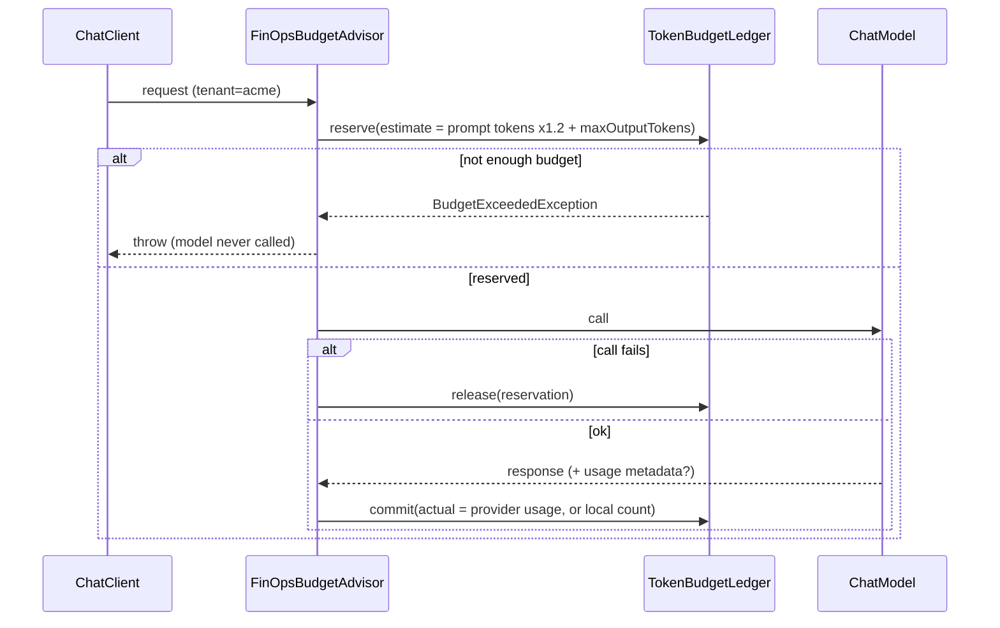

# Part IV pillar: FinOps reserve-call-commit budget advisor

**Status:** done · **Handbook:** Part IV

A Spring AI `CallAdvisor` that gives each tenant a **token budget** and enforces it with the
**reserve, call, commit** pattern. Over-budget calls are blocked **before** the model is called.
Concurrent calls can't overspend, and failed calls give their reservation back.



## What's here
| Path | Purpose |
|---|---|
| [theory.md](theory.md) | Why reserve first; estimates vs actuals; where it sits in the advisor chain |
| [examples/](examples) | Wiring snippets and the runnable `FinOpsDemo` |
| [exercises.md](exercises.md) | Practice tasks |
| `TokenBudgetLedger` | Thread-safe per-tenant ledger (limit, reserved, used) |
| `TokenEstimator` | JTokkit BPE count with a safety margin |
| `FinOpsBudgetAdvisor` | The advisor, which also keeps a `UsageRecord` audit trail |
| `PriceList` | INR per 1K tokens (`FREE` for local Ollama) |

## Tests (10, offline)
- `TokenBudgetLedgerTest` (5):
  - reserve, commit and release;
  - reservations count against the budget;
  - tenants are isolated;
  - a double commit is rejected;
  - **1,000 concurrent virtual-thread reservations grant exactly 333 × 30 tokens out of 10,000**.
- `FinOpsBudgetAdvisorTest` (5):
  - falls back to a local count when the provider reports no usage;
  - prefers provider usage and prices it (`0.1050` INR);
  - an over-budget call is blocked with zero model calls;
  - a failing provider releases its reservation;
  - the budget runs out after repeated calls.

## Run
```bash
mvn -B -pl pillar-finops-budget -am verify
mvn -q -pl pillar-finops-budget -am install -DskipTests
mvn -q -pl pillar-finops-budget exec:java -Dexec.mainClass=io.github.aaronsamuvel.blueprints.finops.FinOpsDemo
```

## Assumptions *(author's design, not from handbook)*
- The ledger is in memory. Production would use Postgres (`SELECT … FOR UPDATE`) or Redis Lua scripts.
- Estimates use OpenAI's cl100k tokenizer, which is only approximate for Llama models; the 1.2× margin covers the difference.
- Budgets are absolute token counts with no time window. A daily or monthly reset is exercise 1.
