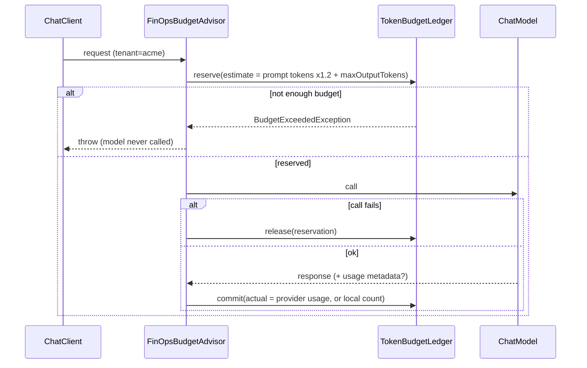

# Part IV pillar: FinOps reserve-call-commit budget advisor

**Status:** done · **Handbook:** Part IV

A Spring AI `CallAdvisor` that gives each tenant a **token budget** and enforces it with the
**reserve, call, commit** pattern. Over-budget calls are blocked **before** the model is called.
Concurrent calls can't overspend, and failed calls give their reservation back.



## What's here
| Path | Purpose |
|---|---|
| [theory.md](theory.md) | Why reserve first; estimates vs actuals; where it sits in the advisor chain |
| [examples/](examples) | Wiring snippets and the runnable `FinOpsDemo` |
| [exercises.md](exercises.md) | Practice tasks |
| `TokenBudgetAuthority` | The reserve/commit/release contract the advisor depends on |
| `TokenBudgetLedger` | Thread-safe in-memory per-tenant ledger (limit, reserved, used) |
| `JdbcTokenBudgetLedger` | PostgreSQL/H2 ledger with **daily** budgets; one atomic conditional `UPDATE … WHERE used + reserved + ? <= limit_tokens` per reservation |
| `TokenEstimator` | JTokkit BPE count with a safety margin |
| `FinOpsBudgetAdvisor` | The advisor, which also keeps a `UsageRecord` audit trail |
| `PriceList` | INR per 1K tokens (`FREE` for local Ollama) |

## Tests (13, offline)
- `TokenBudgetLedgerTest` (5):
  - reserve, commit and release;
  - reservations count against the budget;
  - tenants are isolated;
  - a double commit is rejected;
  - **1,000 concurrent virtual-thread reservations grant exactly 333 × 30 tokens out of 10,000**.
- `FinOpsBudgetAdvisorTest` (5):
  - falls back to a local count when the provider reports no usage;
  - prefers provider usage and prices it (`0.1050` INR);
  - an over-budget call is blocked with zero model calls;
  - a failing provider releases its reservation;
  - the budget runs out after repeated calls.
- `JdbcTokenBudgetLedgerTest` (3, H2 in memory):
  - 32 concurrent virtual-thread reservations of 100 against a 1,000 limit: exactly 10 granted, 22 refused;
  - commit charges actual usage, release returns everything, a double commit is rejected, and the next UTC day starts a fresh budget;
  - the advisor on the JDBC ledger blocks an exhausted tenant with zero model calls.

## Handbook coverage (Part IV, 10.1)
| Handbook step | Status | Where |
|---|---|---|
| High-priority `CallAdvisor` | Done | `FinOpsBudgetAdvisor.ORDER = HIGHEST_PRECEDENCE + 10` |
| Step 1: estimate prompt + completion, atomically reserve in PostgreSQL/Redis | Done (PostgreSQL-compatible SQL, tested on H2) | `TokenEstimator`, `JdbcTokenBudgetLedger.reserve` |
| Daily/monthly budget, `BudgetExceededException` before the HTTP call | Done for daily; monthly is the same code with a `YearMonth` period | `JdbcTokenBudgetLedger` |
| Step 2: continue the chain | Done | `chain.nextCall` |
| Step 3: commit `Usage` from `ChatResponse` metadata, release on failure | Done | `FinOpsBudgetAdvisor` |
| Cost in micro-dollars | Substituted: INR per 1K tokens (`PriceList`) | `UsageRecord.cost` |
| Redis or a Cycles authority service | Not done: no Redis or Cycles server on the box; `TokenBudgetAuthority` is the plug-in point | — |

## Run
```bash
mvn -B -pl pillar-finops-budget -am verify
mvn -q -pl pillar-finops-budget -am install -DskipTests
mvn -q -pl pillar-finops-budget exec:java -Dexec.mainClass=io.github.aaronsamuvel.blueprints.finops.FinOpsDemo
```

## Assumptions *(author's design, not from handbook)*
- `TokenBudgetLedger` is in memory for single-instance demos; use `JdbcTokenBudgetLedger` across instances.
  It has been tested on H2 only, not on a live PostgreSQL.
- Estimates use OpenAI's cl100k tokenizer, which is only approximate for Llama models; the 1.2× margin covers the difference.
- The in-memory ledger has no time window; the JDBC ledger resets daily (UTC by default, via the injected `Clock`).
